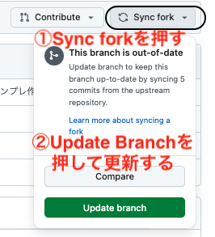
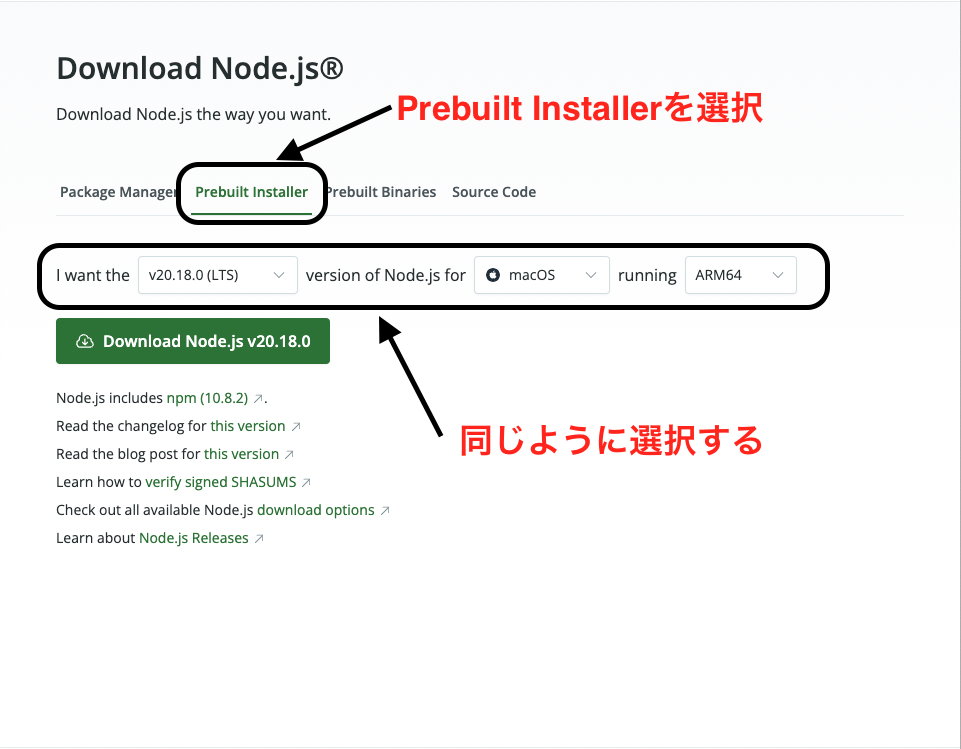
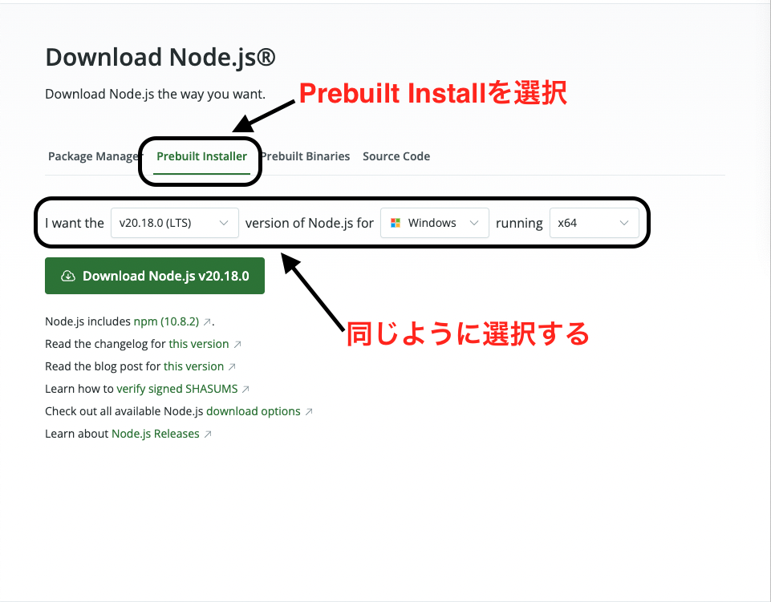
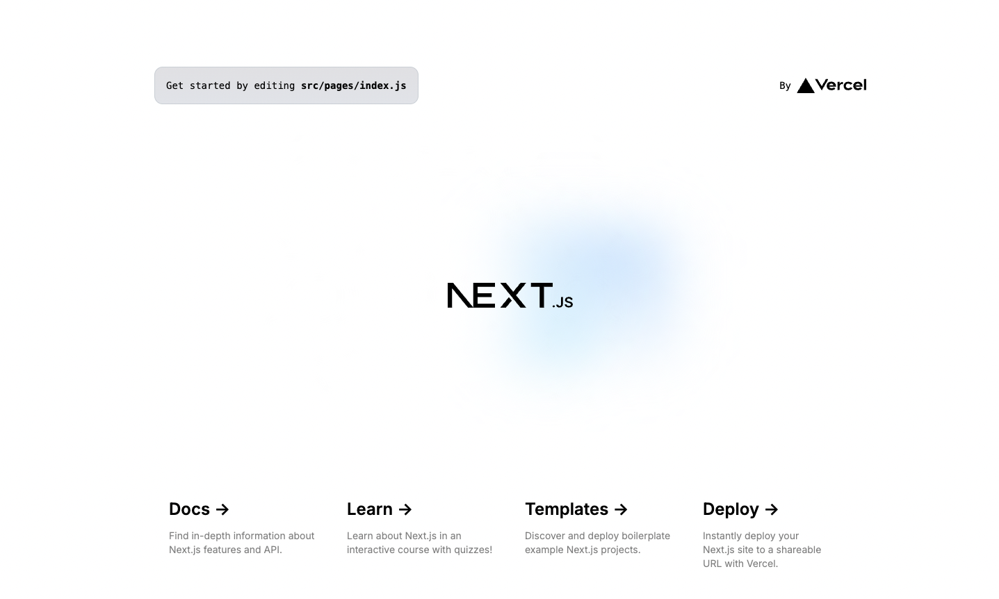
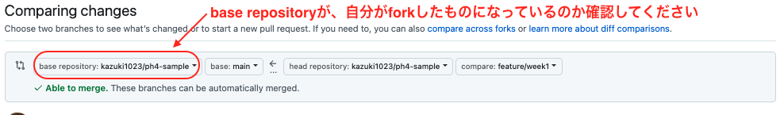
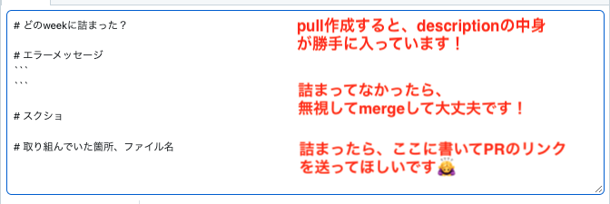

# ph4 week1.2演習用
## 始める前に
- フォーク元のリポジトリが更新されているかもしれません
- [こちら](https://github.com/posse-ap/ph4-sample)にアクセスして、写真に従って、最新のコードを取得してください

## 環境構築方法
1. クローンしたら、以下のコマンドをターミナルでweek1に移動してください
```bash
cd week1
```

2. 以下のコマンドをターミナルで実行してください
```bash
npm install
```

<details><summary> <h3>npm installでエラーが出た人へ</h3></summary>
<p>

おそらく全員が以下のようなエラーが出たと思います...
```shell
command `npm` not found
```

- `npm`なんてcommand知らないよ〜っていうエラーが出ていると思います

### macの人へ
[node公式サイト](https://nodejs.org/en/download/prebuilt-installer)からinstallしましょう
下記画像のように設定して、ダウンロードしましょう


- ダウンロードすると、モーダルが開いて指示が求められるはずなので、その指示に従って行きましょう

```shell
npm -v
10.8.2
```
のように出ていれば大丈夫です！(10.8.2が一致していなくても数字が出ていれば大丈夫です！)
先程の`npm install`を再度実行して、３に進んでください


### windowsの人へ
[node公式サイト](https://nodejs.org/en/download/prebuilt-installer)からinstallしましょう
下記画像のように設定して、ダウンロードしましょう


- ダウンロードすると、モーダルが開いて指示が求められるはずなので、その指示に従って行きましょう
- こちらの参考記事と同じようにやれば大丈夫です
[Node.js / npmをインストールする（for Windows）](https://qiita.com/taiponrock/items/9001ae194571feb63a5e)

```shell
npm -v
10.8.2
```
のように出ていれば大丈夫です！(10.8.2が一致していなくても数字が出ていれば大丈夫です！)
先程の`npm install`を再度実行して、３に進んでください


</p>
</details> 

3. 以下のコマンドをターミナルで実行してください
```bash
npm run dev
```

4. ブラウザで`http://localhost:3000`にアクセスしてください
5. 下記のような画面が表示されれば成功です


## 進め方
- 各week毎にブランチを作成して、そのブランチで作業を行ってください
- 終わったら、mainにPRを作成してmergeしてください

例) week1の場合
1. mainから以下のようなブランチを作成する
```bash
feature/week1
```

2. feature/week1で作業を行う
3. 終わったら、mainにPRを作成して、mergeする



## うまくいかない場合、わからない場合
- とりあえず現状を全部pushしてください
- mainにPRを作成してください
  - **その時、絶対にmergeしないでください**

- そのPRのリンクと、わからなくなった場所、取り組んでいた箇所を記載して、discordに投稿してください
